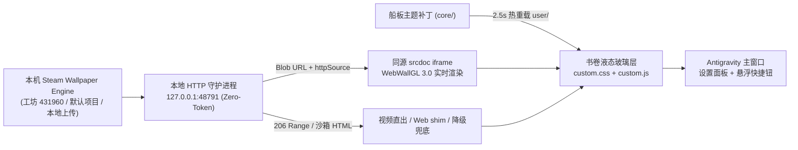

<div align="center">
  
  <h1>agy-wallpaper-engine</h1>
  <p><strong>船板 Antigravity 主题补丁 × Wallpaper Engine 书卷液态玻璃融合插件</strong></p>
  <p>
    让 Google Antigravity 桌面版同时拥有「船板暖纸 / 暖炭排版、1,940 条界面汉化、Token 统计」、「本机 Steam Wallpaper Engine 动态壁纸 + iOS 书卷液态毛玻璃」以及「模型菜单推理等级滑块」。
  </p>
</div>

---

## ✨ 核心特性

- **🧩 合规无损一体集成**：安装器自动检测并按需拉取部署官方 [chuanban-antigravity-theme-patch](https://github.com/Anarcadia/chuanban-antigravity-theme-patch)，再通过其 `user/custom.css` 与 `user/custom.js` 热重载层注入动态壁纸与液态玻璃效果，**零修改船板 `core/` 内核**。
- **🌊 书卷液态毛玻璃**：自动匹配船板全套昼夜预设（白天高对比暖白 / 净白 / 复古羊皮纸；黑夜 Claude 暖纸深夜 / 官方冷碳黑），切换 **☀️ / 📖 / 🌙** 时玻璃色调 0ms 同步切换，同时为代码块、终端与编辑器保留高可读实底。
- **🎬 全壁纸格式与三级无感降级**：
  - **Scene 场景壁纸**：内置开源引擎 `webwallgl` 通过同源 `srcdoc` + `Blob URL` 突破 HTTPS 主窗口混合内容限制，实时渲染粒子、骨骼与动画；若遇复杂工坊着色器受限或加载超时，自动按 **「WebGL 实时渲染 → 内嵌 MP4 视频 → 高清工程预览图」** 无缝降级。
  - **Video 视频 / Web 网页 / 图片项目**：原生支持 HTTP `206` Range 分片视频流、沙箱网页壁纸（自动注入 WE API shim 与默认属性）、本机图片/视频上传与定时轮播。
- **🎛️ 原生双入口控制 & 零 Token 开销**：
  - 入口一：原生嵌入 **「系统设置 → 本地扩展 → 动态壁纸」**（与船板「Token 统计」并列），含搜索筛选、壁纸缩略图库、4 套液态玻璃预设与 4 根实时滑块。
  - 入口二：主窗口右上角极简悬浮 **「壁纸」** 胶囊（左键直达控制台，右键随机换壁纸，支持隐藏）。
  - 全部设置与媒体由纯本地 `127.0.0.1:48791` 守护进程托管，日常对话 **0 额外 Token 消耗**；注册为 Antigravity 原生插件后，也支持随时用自然语言让 AI 帮你换壁纸、调参数。
- **🔋 智能省电与避让**：窗口最小化、失焦（可配置）或打开 Antigravity 内置浏览器打孔时自动暂停渲染与视频解码并让出透明视野。
- **🎚️ 模型菜单推理等级滑块（兼容船板汉化）**：在输入框下方的模型选择菜单底部挂载动态星尘/点阵推理等级滑块，支持主模型列表与 `Orchestrator` 规划器档位联动及独立记忆；内置中英文等价防闪烁与 `!important` 亮色穿透机制，避免与船板汉化及菜单全局配色冲突，并可在「动态壁纸」设置面板中一键开关。

---

## 🏗️ 工作架构



---

## 🚀 一键全套安装

前置环境：**Node.js >= 22.0.0**（推荐 >= 22.13.0 以完整开启船板实时指标与 Token 统计）+ **Git**。

### 方式 A：终端一条命令全套自动安装（推荐）

```bash
git clone https://github.com/3269890146/agy-wallpaper-engine.git
cd agy-wallpaper-engine
node install.mjs install
```

运行 `node install.mjs install` 将自动依次完成：
1. 安装 `webwallgl` 引擎依赖；
2. 检测本机是否已装船板主题补丁，未装时自动拉取官方最新版并完成部署；
3. 备份原 `user/` 配置并将书卷液态玻璃层写入船板扩展钩子；
4. 安装 Antigravity 原生插件清单至 `~/.gemini/config/plugins/agy-wallpaper-engine/`；
5. 注册后台壁纸守护自启服务（Windows 计划任务 / macOS LaunchAgent / Linux systemd）并立即启动。

> 💡 若你已在 Antigravity 内部会话中执行安装，且本机 Antigravity 未带 `--remote-debugging-port=0` 启动，请在安装结束后**手动退出并重开一次 Antigravity** 即可生效（之后日常使用都会无感自动注入）。

### 方式 B：直接发给 AI Agent 自动部署

> **💬 复制发给 Antigravity / Claude Code / Codex**：  
> 请帮我克隆 `https://github.com/3269890146/agy-wallpaper-engine.git` 到本地工作区，检查当前 Node.js 版本（>= 22），然后运行 `node install.mjs install` 一键完成船板主题补丁与 Wallpaper Engine 书卷液态玻璃插件的全套部署。如果我正在 Antigravity 对话中且缺少调试端口参数，请不要强制强杀客户端，提示我对话结束后手动重启一次 Antigravity 即可。

---

## 🎨 日常使用与控制

1. **可视化调优**：点击右上角悬浮 **「壁纸」** 按钮（或进入 **「系统设置 → 本地扩展 → 动态壁纸」**），可自由调整：
   - 玻璃预设：`书卷液态玻璃` / `澄澈高透` / `浓墨磨砂` / `仅对话区透出`
   - 实时滑块：主对话区不透明度、侧边栏玻璃浓度、液态玻璃模糊半径、护眼柔光遮罩
   - 快捷开关：支持开启/关闭右上角悬浮快捷钮、**模型菜单推理等级滑块**（点开输入框下方模型选择菜单即可在底部拖动切换 `Low` / `Medium` / `High` / `Extra` 等档位）
   - 壁纸库：按 `场景 / 视频 / 网页 / 本地导入` 筛选，支持上传本地 `jpg/png/webp/gif/mp4/webm`
2. **自然语言操控**：在 Antigravity 对话中直接提问（会自动匹配本插件内置的 `agy-wallpaper-engine` Skill）：
   - *“帮我换下一张动态壁纸”*
   - *“搜一下库里有没有赛博朋克或者星空壁纸”*
   - *“把侧边栏调透一些，模糊度改成 20px”*
3. **跨平台 Steam 库提示**：如果 Steam 安装在非常规目录且未被自动扫到，可设置环境变量 `AGY_WE_STEAM_ROOT=<你的 Steam 目录>` 后重启服务，或直接在设置面板导入本地视频/图片使用。

---

## 🛠️ 运维命令速查

```bash
# 查看壁纸服务、船板补丁与插件状态
node install.mjs status

# 手动启停后台壁纸服务
node install.mjs start
node install.mjs stop

# 同步更新本地官方船板主题补丁并保留本融合插件
node install.mjs install --update-chuanban

# 修改 client/ 源码后一键热重载到客户端
node install.mjs sync-ui

# 仅卸载壁纸扩展（保留纯净船板主题补丁）
node install.mjs uninstall

# 彻底卸载（连同船板主题补丁一并还原为官方原版界面）
node install.mjs uninstall --full
```

---

## 🙏 致谢与开源合规

- **[elysia395/dsh-wallpaper-engine](https://github.com/elysia395/dsh-wallpaper-engine)**（MIT）：参考学习了 `.pkg` 容器头部索引读取、Steam 库探测、`webwallgl` 挂载与 WE API shim 注入设计。
- **[webwallgl](https://www.npmjs.com/package/webwallgl)**（MIT）：核心 WebGL 场景实时渲染库。
- **[Anarcadia/chuanban-antigravity-theme-patch](https://github.com/Anarcadia/chuanban-antigravity-theme-patch)**：提供了优雅的昼夜书卷配色、四层字体引擎、1,940 条界面汉化、Token 统计与 `2.5s` 热重载扩展基础。本仓库不包含其源码，仅在安装时自动按需拉取官方仓并通过 `user/` 钩子协同工作。
- **[LLYSH-HANNARI/antigravity-Codex-Claude-effort-slider](https://github.com/LLYSH-HANNARI/antigravity-Codex-Claude-effort-slider)**（MIT）：提供了模型菜单推理等级滑块核心组件（`client/effort-slider.js`），本项目在其基础上补充了受控生命周期管理及船板汉化/高亮样式兼容。
